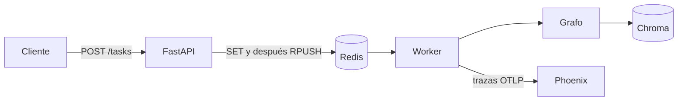
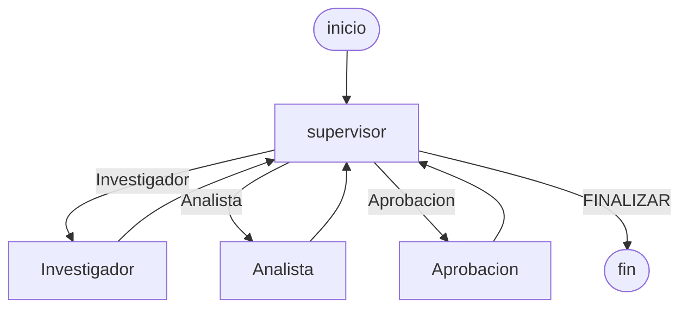

# Entrega final: Intelligence System

Curso **AI Engineer — Coderhouse**. Un solo sistema junta el RAG híbrido, el supervisor del módulo 6 y la API del módulo 7. Una consulta entra por HTTP, el investigador lee políticas y reseñas, el analista puntúa, y si hay que publicar un destacado el hilo espera a una persona. Cada paso queda en una traza.

## Estructura

```text
entrega-final-intelligence-system/
├── app/
│   ├── main.py            # POST /tasks · GET /tasks/{id} · POST /tasks/{id}/approve
│   ├── graph.py           # supervisor, investigador, analista y aprobación
│   ├── knowledge.py       # Chroma + ranking léxico (RRF)
│   ├── worker.py          # cola y estados pending / running / waiting_approval / done / failed
│   ├── observability.py   # tramo por nodo y OpenInference hacia Phoenix
│   ├── hitl.py            # interrupt y, después, publicar_destacado
│   └── checkpointer.py    # AsyncRedisSaver
├── data/politicas/        # conocimiento del RAG
├── data/resenas/          # fichas del módulo 6
├── cargar.py              # 5 peticiones concurrentes
├── docker-compose.yml
├── screenshots/
└── README.md
```

## Cómo se mueve un pedido



El `POST` guarda `pending` y devuelve el `job_id`. El `thread_id` del checkpointer es ese mismo id, así que la conversación sigue en Redis si el proceso se reinicia.

## Grafo



El investigador llama a `buscar_conocimiento` y después a `buscar_resenas`. La primera lectura es por aspecto. Si no hay dos reseñas, el supervisor pide ampliar al producto: es el refinamiento del módulo 6. El analista solo puntúa. Si `destacar` es verdadero, `Aprobacion` corta con `interrupt` y el efecto `publicar_destacado` corre recién con el resume.

El Mermaid del grafo compilado queda en `evidencia/grafo.mmd`.

## RAG

Las políticas de `data/politicas/` se indexan en Chroma al arrancar. Con `EMBEDDING_PROVIDER=local` el vector es por token y no usa la red. Con `openai`, usa `OPENAI_EMBEDDING_MODEL`. El ranking vectorial se fusiona con el léxico mediante RRF. La colección sale de `CHROMA_COLLECTION`. El modelo de chat sale de `OPENAI_MODEL`.

## API

| Método | Ruta | Qué hace |
| --- | --- | --- |
| `POST` | `/tasks` | valida con Pydantic y responde `202` con `job_id` |
| `GET` | `/tasks/{job_id}` | `pending`, `running`, `waiting_approval`, `done` o `failed` |
| `POST` | `/tasks/{job_id}/approve` | `{"approved": true}` o `false` |

OpenAPI queda en `http://localhost:8000/docs`. Una excepción del worker deja el trabajo en `failed`.

## Cómo levantarlo

Una sola instrucción, desde esta carpeta:

```powershell
copy .env.example .env
.\run.ps1
```

`run.ps1` ejecuta `docker compose up --build`. Redis Stack queda en el 6379, Phoenix en el 6006 y la API en el 8000. En bash, `./run.sh`.

## Cinco pruebas

Con la API arriba:

```powershell
python cargar.py
```

Son cinco `POST /tasks` concurrentes con el pedido de la Notebook 14. Cada uno vuelve enseguida. Cuando el estado es `waiting_approval`:

```powershell
curl -X POST http://127.0.0.1:8000/tasks/EL-JOB-ID/approve -H "Content-Type: application/json" -d "{\"approved\": true}"
```

Sin Docker ni API key:

```powershell
pip install -r requirements.txt
python verificar_rubrica.py
```

Esa corrida usa Redis en memoria para la cola y SQLite para el checkpointer, y deja el resultado en `evidencia/verificacion.txt`. El despliegue de la consigna sigue siendo Redis.

## Trazas

Phoenix muestra el proyecto `intelligence-system` en `http://localhost:6006`. En `screenshots/trazas.png` está el listado de las cinco pruebas y en `screenshots/latencia-p95.png` el gráfico de percentiles: en esa corrida la p95 fue 327 ms. El costo figura en $0 porque el modelo de ensayo no emite tokens. Con `OPENAI_API_KEY`, Phoenix lo calcula solo a partir de los tokens de `OPENAI_MODEL`.
