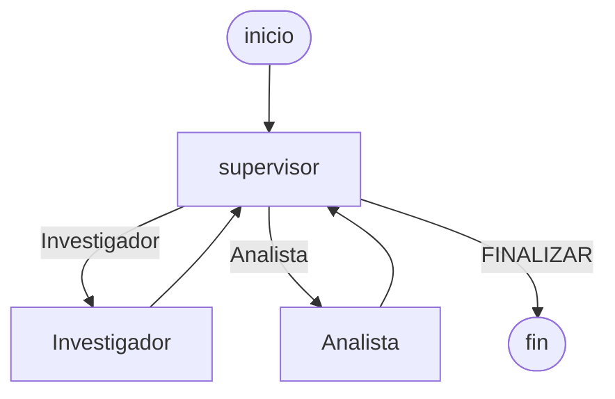

# Pre-entrega 6: Orquestador multi-agente especializado

Curso **AI Engineer — Coderhouse**. Orquestador jerárquico que investiga reseñas y calcula si el sentimiento alcanza para destacar un producto. El supervisor decide el siguiente nodo. Los especialistas no se hablan entre sí.

## Estructura

```text
pre-entrega-6-orquestador-multiagente/
├── state.py                     # AgentState(MessagesState) y artefactos Pydantic
├── graph.py                     # StateGraph, supervisor y aristas condicionales
├── main.py                      # corrida con ChatOpenAI
├── trace.py                     # traza de delegación
├── agents/
│   ├── research_agent.py        # ReAct de búsqueda sobre las fichas
│   └── analyst_agent.py         # ReAct de sentimiento
├── data/resenas/                # corpus local, una ficha por reseña
├── demo_flujo.ipynb             # demo del flujo, sin API
├── verificar_rubrica.py         # ciclo completo sin API key
├── evidencia/traza_delegacion.json
├── evidencia/traza_delegacion.log
├── evidencia/grafo.mmd
├── .env.example
└── requirements.txt
```

## Topología

Jerárquica. El pedido entra al supervisor. Él elige `Investigador`, `Analista` o `FINALIZAR`. Cada especialista vuelve al supervisor con su parcela y no ve la parcela del otro.



`Investigador` y `Analista` son grafos ReAct propios (`create_react_agent`). Adentro, el modelo llama a sus herramientas y vuelve. El grafo padre solo ve la decisión del supervisor. El Mermaid que emite el grafo compilado queda en `evidencia/grafo.mmd`.

La colaboración entre pares no entra en este trámite. El orden es conocido: primero hay que tener reseñas, después puntuarlas, y solo entonces cerrar. La respuesta usa números que comprometen una decisión de negocio, así que el supervisor es el validador final.

## Estado

`AgentState` hereda de `MessagesState`. `messages` se acumula con `add_messages`. El resto se pisa: cada uno escribe lo suyo.

| Campo | Quién lo escribe | Qué guarda |
| --- | --- | --- |
| `research` | Investigador | consulta, textos, fuentes, muestra, confidence |
| `analysis` | Analista | score, muestra, sentimiento, suficiente, destacar |
| `next` | Supervisor | `Investigador`, `Analista` o `FINALIZAR` |
| `steps` | Supervisor | decisiones ya tomadas |
| `task_completed` | Supervisor | verdadero solo si el análisis alcanza el mínimo |

`ResearchArtifact` y `AnalysisArtifact` validan con Pydantic. `confidence` y `score` tienen que estar entre 0 y 1. `findings` es una lista de textos, no un string libre. Si el artefacto no valida, el nodo loguea el motivo y no pisa la parcela anterior.

## Quién ve qué

El supervisor no recibe el historial crudo. Recibe un JSON con el pedido, el paso, el tope y el resumen de cada parcela. Su prompt es una rúbrica: sin investigación va al investigador; sin análisis, al analista; si la muestra creció y el análisis anterior no alcanzaba, el analista recalcula; si `suficiente` es verdadero, cierra.

El investigador recibe el pedido y `muestra_actual`. No recibe el score. El analista recibe el bloque `DATOS` con los textos ya aceptados. No recibe las fichas ni la rúbrica.

## Herramientas

El investigador:

- `buscar_resenas` lee las cuatro fichas de `data/resenas/` con `asyncio.gather` y se queda con las que coinciden.
- `obtener_resena` abre una ficha por id.

El analista:

- `calcular_sentimiento` promedia el léxico de los textos. `suficiente` exige al menos 2 reseñas. `destacar` exige eso y un score de al menos 0.7.

El número no lo redacta el modelo. El nodo arma el artefacto con el JSON de la herramienta.

## Corte

`MAX_STEPS` está en 6. Cada decisión del supervisor suma uno. Al pasar el tope, el nodo cierra en `FINALIZAR` aunque el modelo vuelva a pedir un especialista. `task_completed` queda en falso si la muestra no alcanzó. Eso evita el bucle de correcciones.

## Conflicto entre agentes

No comparten una lista global ni se pisan el campo. Si el analista corre con una muestra corta, deja `suficiente: false` y el supervisor manda al investigador a ampliar. La parcela nueva reemplaza a la anterior solo cuando valida. Una búsqueda vacía o un score fuera de rango se loguea y se descarta.

## Instalación

Desde esta carpeta, con el entorno de la raíz del monorepo o con uno nuevo:

```powershell
py -3.12 -m venv .venv
.\.venv\Scripts\Activate.ps1
python -m pip install --upgrade pip
pip install -r requirements.txt
copy .env.example .env
notepad .env
```

Si ya existe el `.venv` de la raíz:

```powershell
..\.venv\Scripts\Activate.ps1
pip install -r requirements.txt
copy .env.example .env
```

`.env`:

```dotenv
OPENAI_API_KEY=sk-...
OPENAI_MODEL=gpt-4o-mini
MAX_STEPS=6
RECURSION_LIMIT=30
```

La clave no se versiona. El `.gitignore` de la raíz ignora `.env`.

## Cómo correrlo

Sin API. El modelo de esta corrida es determinista y las herramientas leen las fichas reales. El pedido obliga a una lectura de la batería, un análisis corto, una ampliación al producto y el cierre.

```powershell
python verificar_rubrica.py
```

Con OpenAI, el mismo pedido:

```powershell
python main.py
```

El notebook `demo_flujo.ipynb` muestra la misma delegación, también sin API.

La corrida de control hace este recorrido:

1. El supervisor manda al investigador. `buscar_resenas("batería")` deja una sola reseña y `confidence` 0.45.
2. El analista puntúa esa reseña. El score es alto, pero `suficiente` queda en falso porque hace falta más de una.
3. El supervisor devuelve al investigador. `buscar_resenas("Notebook 14")` trae tres fichas y `obtener_resena` abre una.
4. El analista recalcula: score 0.89, `suficiente` verdadero, conviene destacarla.
5. El supervisor cierra. `task_completed` queda en verdadero. La síntesis nombra las tres fuentes y el score.

## Traza

`evidencia/traza_delegacion.json`, `evidencia/traza_delegacion.log` y `evidencia/grafo.mmd`.

La copia versionada sale de `python verificar_rubrica.py`. Después de `python main.py`, el mismo archivo queda con la corrida de `gpt-4o-mini`.

## Corpus

| Id | Producto | Qué dice |
| --- | --- | --- |
| rev-nb-1 | Notebook 14 | Rápida, la batería dura, la recomienda. |
| rev-nb-2 | Notebook 14 | Excelente, teclado cómodo, pantalla bien. |
| rev-nb-3 | Notebook 14 | Llegó tarde, pero funciona bárbaro. |
| rev-au-1 | Auriculares | Sonido malo, se rompieron. |

La consulta `batería` encuentra solo la primera. `Notebook 14` encuentra las tres. Los auriculares no entran en ese pedido.
