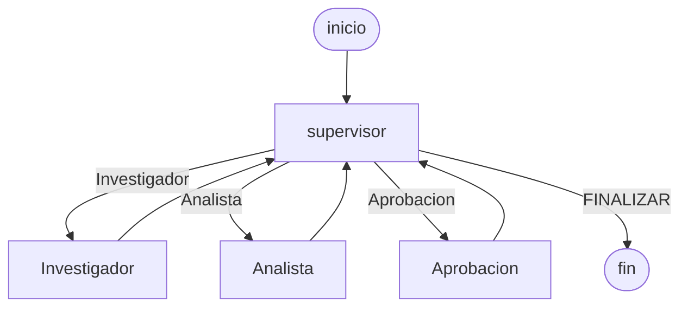

# Pre-entrega 7: API de producción y monitoreo

Curso **AI Engineer — Coderhouse**. La API expone el orquestador del módulo 6. El `POST` encola el pedido y devuelve un `job_id`. Redis guarda el estado del trabajo y los checkpoints del grafo. Si el análisis pide publicar un destacado, el hilo se pausa hasta que una persona aprueba.

## Estructura

```text
pre-entrega-7-api-agente/
├── app/
│   ├── main.py            # POST /tasks · GET /tasks/{id} · POST /tasks/{id}/approve
│   ├── graph.py           # supervisor, investigador y analista del módulo 6
│   ├── worker.py          # corre la cola y marca running / waiting_approval / done / failed
│   ├── observability.py   # tramo por nodo y OpenInference hacia Phoenix
│   ├── hitl.py            # interrupt y, recién después, publicar_destacado
│   └── checkpointer.py    # AsyncRedisSaver
├── data/resenas/          # las mismas fichas de la pre-entrega 6
├── cargar.py              # 5 peticiones concurrentes
├── docker-compose.yml     # Redis Stack, Phoenix y la API
├── screenshots/           # capturas del dashboard
└── README.md
```

## Grafo

El pedido entra al supervisor. Él elige `Investigador`, `Analista`, `Aprobacion` o `FINALIZAR`. La regla de refinamiento es la del módulo 6: si la primera lectura no junta 2 reseñas, se amplía al producto. Publicar el destacado es la acción crítica.



`Aprobacion` llama a `interrupt`. El worker deja el trabajo en `waiting_approval` y el `thread_id` (el `job_id`) queda en Redis. El `POST /tasks/{id}/approve` con `{"approved": true}` encola el resume. Recién ahí corre `publicar_destacado`.

## API

| Método | Ruta | Qué hace |
| --- | --- | --- |
| `POST` | `/tasks` | valida la consulta, guarda `pending` y responde `202` con `job_id` |
| `GET` | `/tasks/{job_id}` | `pending`, `running`, `waiting_approval`, `done` o `failed` |
| `POST` | `/tasks/{job_id}/approve` | `{"approved": true}` o `false`, solo si está esperando |

OpenAPI queda en `http://localhost:8000/docs`. Si el worker tira una excepción, el estado pasa a `failed`.

## Cómo levantarlo

Desde esta carpeta, con Docker:

```powershell
copy .env.example .env
.\run.ps1
```

Eso ejecuta `docker compose up --build`. Redis Stack escucha en el 6379, Phoenix en el 6006 y la API en el 8000. Completá `OPENAI_API_KEY` en `.env` para que el dashboard calcule el costo con los tokens de `OPENAI_MODEL`. Sin la key, la API usa el modelo de ensayo y Phoenix no tiene tokens para costear.

## Cinco peticiones concurrentes

Con la API ya arriba:

```powershell
python cargar.py
```

Son cinco `POST /tasks` al mismo tiempo, con el pedido de la Notebook 14. Cada uno devuelve enseguida. Cuando el `GET` diga `waiting_approval`:

```powershell
curl -X POST http://127.0.0.1:8000/tasks/EL-JOB-ID/approve -H "Content-Type: application/json" -d "{\"approved\": true}"
```

## Capturas

En `screenshots/` ya hay tres tomas de Phoenix (`http://localhost:6006`, proyecto `api-agente`) después de las cinco peticiones:

- `trazas.png`: spans de esa corrida. En el panel de la derecha, Total Cost figura en **$0** porque el modelo de ensayo no emite tokens.
- `latencia-p95.png`: percentiles de latencia. En esa corrida la p95 quedó en 265 ms.

Para que el costo salga de los tokens de verdad, completá `OPENAI_API_KEY`, levantá la API con `.\run.ps1`, corré `python cargar.py` y sacá de nuevo el panel de costo del proyecto `api-agente`. Guardalo como `screenshots/costo.png`.

## Verificación sin Docker

`python verificar_rubrica.py` no necesita Redis Stack ni la key. Usa Redis en memoria para la cola y SQLite para el checkpointer, y deja el resultado en `evidencia/verificacion.txt`. El despliegue de la consigna sigue siendo Redis: `CHECKPOINT_BACKEND=redis` y `AsyncRedisSaver`.
