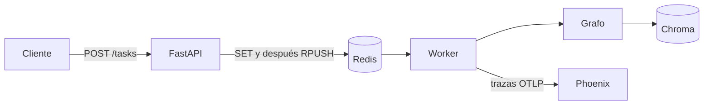
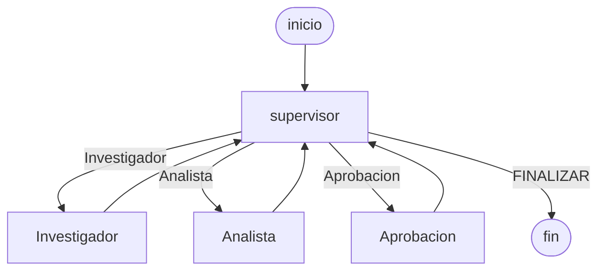

# Pre-entrega 7: Sistema de inteligencia comercial

Curso **AI Engineer — Coderhouse**. Sistema que junta el RAG, el supervisor del módulo 6 y una API de producción. Una consulta entra por HTTP, vuelve enseguida con un `job_id`, y el grafo corre en un worker. Si el resultado pide publicar un destacado, el hilo queda pausado hasta que una persona aprueba o rechaza.

## Estructura

```text
pre-entrega-7-intelligence-system/
├── app/
│   ├── main.py            # FastAPI: alta, estado y aprobación
│   ├── worker.py          # saca la cola y corre el grafo
│   ├── jobs.py            # estado en Redis antes de encolar
│   ├── graph.py           # supervisor y aristas condicionales
│   ├── hitl.py            # interrupt de publicación
│   ├── checkpointer.py    # Redis o SQLite, según el entorno
│   ├── knowledge.py       # Chroma + ranking léxico (RRF)
│   ├── observability.py   # OpenTelemetry y evidencia/trazas.jsonl
│   ├── agents/            # investigador y analista
│   └── state.py           # contratos Pydantic
├── data/resenas/          # fichas de reseña
├── data/politicas/        # políticas que indexa el RAG
├── docker-compose.yml     # Redis Stack, Phoenix y la API
├── Dockerfile
├── run.ps1 / run.sh       # un solo comando
├── verificar_rubrica.py   # la rúbrica, sin API key
└── evidencia/
```

## Cómo se mueve un pedido



El `POST` no espera al modelo. Guarda `pending` en `status:{job_id}` y recién ahí empuja el id a `tasks_queue`. El `GET /tasks/{job_id}` puede responder en el mismo instante.

## Grafo

Jerárquico. El supervisor elige el siguiente nodo y no ejecuta herramientas. Cada especialista vuelve al supervisor con su parcela.



`Investigador` y `Analista` son grafos ReAct (`create_react_agent`). El investigador llama a `buscar_conocimiento` y `buscar_resenas`. El analista solo llama a `calcular_sentimiento`. El nodo `Aprobacion` no usa un modelo: si el análisis pide destacar, llama a `interrupt` y el `thread_id` queda en el checkpointer.

El Mermaid que emite el grafo compilado queda en `evidencia/grafo.mmd`.

| Nodo | Escribe | Lee |
| --- | --- | --- |
| supervisor | `next`, `steps`, el mensaje de síntesis | el resumen JSON de las parcelas |
| Investigador | `research` | el pedido, en un brief corto |
| Analista | `analysis` | el bloque `DATOS` de la investigación |
| Aprobacion | `aprobado`, `publicado` | el análisis |

El supervisor no recibe el historial de herramientas. Si `steps` pasa `MAX_STEPS`, cierra el pedido.

## RAG

Las políticas de `data/politicas/` se indexan en Chroma al arrancar. Con `EMBEDDING_PROVIDER=local` el vector es por token y no usa la red. Con `openai`, Chroma usa `OPENAI_EMBEDDING_MODEL`. La recuperación mezcla ese ranking con un conteo léxico y los fusiona con RRF. La colección sale de `CHROMA_COLLECTION`.

## API

| Método | Ruta | Qué hace |
| --- | --- | --- |
| `GET` | `/health` | vida del proceso |
| `POST` | `/tasks` | valida con `TareaEntrada` y responde `202` con `job_id` |
| `GET` | `/tasks/{job_id}` | `pending`, `running`, `waiting_approval`, `completed` o `failed` |
| `POST` | `/tasks/{job_id}/approve` | `{"approved": true}` o `false`. Solo si el trabajo espera |

OpenAPI queda en `http://localhost:8000/docs`.

Estados: si el worker tira una excepción, el trabajo pasa a `failed` y el `GET` no se queda en `pending`. Una consulta vacía responde `422`. Un id que no existe responde `404`. Aprobar un trabajo cerrado responde `409`.

## Aprobación

La política pide un revisor humano antes de publicar un destacado. Cuando el analista marca `destacar`, el supervisor manda el hilo a `Aprobacion`. `interrupt` corta la corrida y el worker guarda `waiting_approval` con la pregunta, el producto, el score y la muestra. El `POST` de aprobación encola un `resume` (`si` o `no`) en la misma cola. El worker retoma el hilo con `Command` y el mismo `thread_id`.

Un rechazo deja el texto "no se publica". Una aprobación deja "se publica" y cita las fichas.

## Persistencia y trazas

`CHECKPOINT_BACKEND=redis` usa `AsyncRedisSaver` contra Redis Stack (`asetup` crea los índices). `CHECKPOINT_BACKEND=sqlite` usa `AsyncSqliteSaver`: es el modo de `verificar_rubrica.py`, que no necesita Redis Stack. El `thread_id` es el `job_id`. Cerrar el proceso y volver a abrir el mismo archivo conserva los mensajes.

Cada trabajo abre un tramo `tarea`. Los nodos abren `supervisor`, `investigador`, `analista` y `aprobacion`. Todos llevan `prompt.version` (`PROMPT_TEMPLATE_VERSION`). Con `PHOENIX_COLLECTOR_ENDPOINT` las trazas salen por OTLP HTTP. Siempre se appendean en `evidencia/trazas.jsonl`.

## Cómo correrlo

Con Docker, desde esta carpeta:

```powershell
copy .env.example .env
.\run.ps1
```

En bash, `./run.sh`. Los dos ejecutan `docker compose up --build`. Levantan Redis Stack, Phoenix en el puerto 6006 y la API en el 8000. Phoenix se mira en `http://localhost:6006`.

Sin Docker, y sin API key, la verificación usa el modelo de ensayo, Redis en memoria y el checkpointer SQLite:

```powershell
pip install -r requirements.txt
python verificar_rubrica.py
```

Para servir la API en la máquina, con la misma configuración:

```powershell
$env:FORCE_ENSAYO = "1"
$env:CHECKPOINT_BACKEND = "sqlite"
$env:REDIS_URL = "fakeredis://"
uvicorn app.main:app --reload
```

Con una key de OpenAI, dejá `FORCE_ENSAYO=0` y `OPENAI_API_KEY` en `.env`. El modelo sale de `OPENAI_MODEL`.

## Qué cubre la verificación

`python verificar_rubrica.py` corre sin red y deja `evidencia/verificacion.txt`:

1. Cinco `POST` concurrentes. La Notebook 14 (score 0.89, 3 reseñas) espera aprobación. Los auriculares cierran en 0.00 y no se destacan.
2. La pregunta de política y un producto inexistente no inventan fichas: citan el RAG o dicen que no hay reseñas.
3. Un rechazo no publica. Una aprobación sí, y cita las fuentes.
4. Una excepción del worker marca `failed`.
5. El hilo sigue en el checkpointer después de cerrar y reabrir el grafo.
6. Quedan al menos cinco trazas con la versión del prompt.

El corpus es el de la pre-entrega 6: `rev-nb-1`, `rev-nb-2` y `rev-nb-3` para la Notebook 14, y `rev-au-1` para los auriculares.
